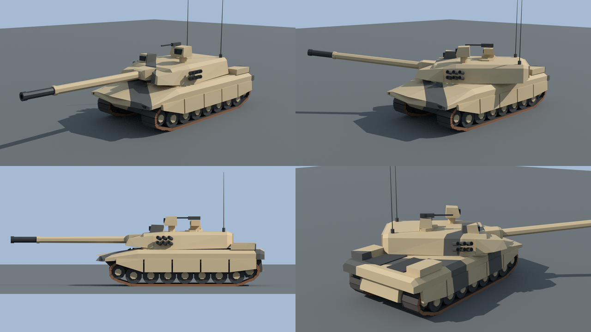
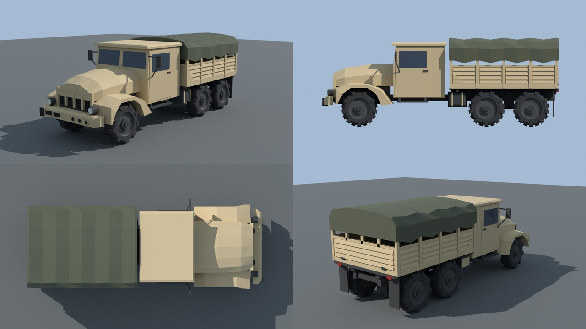
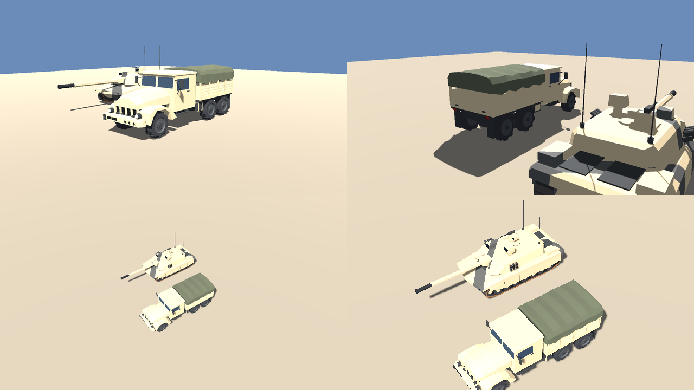

# gdpyr — Unit models: the tank, whose turret turns free of its hull, and the supply truck

The tank was drawn as its collision capsule: a 3 m by 1.3 m pill in its colour. It is now drawn as a
low-poly, faceted main battle tank built in Blender, whose turret turns on its own: the hull faces
the way the tank is going and the turret what it is shooting at. The supply truck, also a capsule
until now, is drawn as a six-wheeled cargo truck with a canvas tilt, built the same way, and faces
the way it is going too (§7). §1 to §6 are the tank's.

| What | Where |
|---|---|
| generator (geometry, materials, camouflage, hierarchy, export, preview renders) | `tools/blender/tank.py` |
| the scene it builds, to open by hand | `tools/blender/Tank.blend` |
| the model the game draws | `Models/Vehicles/tank/tank.glb` |
| which unit draws it, and that it has a turret | `Units/tank.tres` (`Model`, `HasTurret`) |
| drawing it and laying the turret | `Scripts/Rts/Unit.cs` (`BuildModel`, `FaceTravelAndLay`, `TurretYaw`) |
| the turret on the wire | `Scripts/Sim/UnitSnapshotCodec.cs`, `Scripts/Sim/Quantize.cs` (`TurretYawToU8`) |
| engine check | `tools/EngineChecks/TankModelChecks.cs`, `scripts/tank-model-checks.sh` |

---

## 1. What is asked, and what is not

The capsule needed replacing with a model of a tank, after a concept painting: a long hull with a
wedge nose and angular fenders, thick segmented skirts over seven road wheels a side, a wide low
turret with arrowhead cheeks and a bustle, smoke dischargers, a commander's and a gunner's sight, a
remote weapon station, two whip antennas, and a long gun in a faceted thermal sleeve with a dark
muzzle — desert tan with dark camouflage bands. The turret must turn free of the body.

Not changed: what the tank collides with and is hit as (still its capsule, §3.3), where its shots
leave from and where they go, how fast it turns to its target, and its stats. No markings or
lettering from the painting are reproduced.

---

## 2. The model

Built by script, as the bridge and the launcher are, so every dimension is a number in `PARAMS` and
the `.glb` is reproducible:

```bash
python3 -m pip install bpy==5.3.0        # Blender as a module; needs Python 3.13
python3 tools/blender/tank.py            # or: blender --background --python tools/blender/tank.py
python3 tools/blender/tank.py --render /some/dir   # also preview renders (Cycles on the CPU)
```

It writes `Models/Vehicles/tank/tank.glb` and `tools/blender/Tank.blend`, and prints each part's
triangles and extents in Godot's axes. At the time of writing: 5,498 triangles — hull 4,144 (of it the
running gear, link by link), turret 1,166, gun 188.

Two runs give the same model but not the same bytes: every primitive has the same vertices and the
same area, to 0.1 mm², and some flat faces are cut into triangles along other diagonals
(`bmesh.ops.convex_hull` does not return its faces in the same order each time). So a `.glb` that
shows as changed after a re-run with nothing else changed has not changed in any way that is drawn.

**Axes and origin.** Blender +Y is the front, +Z up; the glTF exporter's (x, y, z) → (x, z, −y)
puts the nose down Godot's −Z, which is where a unit at yaw 0 faces (`Aim.Angles`). The origin is on
the ground under the middle of the hull: a `CharacterBody3D`'s position is its feet.

**Hierarchy.** What makes the turret free of the body:

```
Hull            the hull, skirts, wheels and tracks: one mesh, origin on the ground
  Turret        origin on the turret ring's axis, on the hull roof (1.30 m up, 0.15 m ahead of the middle)
    Gun         origin on the trunnions
      Muzzle    an empty at the muzzle face, on the bore axis, 6.07 m ahead of the hull's middle
```

The turret's rotation about its own vertical axis is its yaw against the hull; the gun's about its
own X is its elevation. In the `.blend` the turret's X and Y rotations and the gun's Y and Z are
locked, so they turn only the ways the game turns them.

**Size.** 6.0 m over the hull, 9.0 m from the rear plate to the muzzle, 3.0 m across the skirts;
the hull roof is 1.30 m up, the turret roof 1.92 m, the commander's sight 2.48 m, and the antennas
reach 4.0 m. It is bigger than its 2.6 m-wide capsule fore and aft: §3.3.

**Paint.** Nine materials, flat-shaded, no textures: tan, a dark camouflage grey, a dark grey for
fittings, three for the track (links, alternate grouser links, and a rust-brown edge), gunmetal,
dark glass for sights and lights, and black for the bore. The camouflage bands are planes cut through
the mesh (`bmesh.ops.bisect_plane`) with the faces between them painted, so a band's edges are crisp
whatever the polygon count; the turret's are cut in the hull's frame at rest.



---

## 3. In the game

### 3.1 Drawing it

`UnitDefinition.Model` is a `PackedScene` a vehicle is drawn as in place of its capsule; null keeps
the capsule. `Unit.BuildBody` instances it under the unit as `Model`, finds the node named `Turret`,
and turns every `GeometryInstance3D` in it to cast no shadow, as the capsule cast none. A dedicated
server draws nothing, as before. When the tank dies it is hidden and its wreck goes up as before;
the wreck's debris is the definition's `Color`, now the model's tan.

### 3.2 Laying the turret

`UnitDefinition.HasTurret` is true for the tank. Where every other unit is turned whole each tick
to face its target, or else where it is going (`Unit.FaceTowards`), a turreted unit calls
`Unit.FaceTravelAndLay` after it has moved:

- **the hull** turns to its velocity when it is going faster than 0.5 m/s and is not yet within its
  arrival radius of where it is going, and otherwise keeps the way it faces — so a tank that stops
  to fight does not swing its hull round, and one parked on a move order does not shake (§7.3);
- **the turret** turns to the target, or to the place it is firing on, and back square to the hull
  when it has neither. Its yaw against the hull is `Unit.TurretYaw`, in [−π, π).

Both turn at 6 rad/s, the rate a unit always turned to face its target, so the gun is on a target
as soon as the whole tank used to be. Facing is still cosmetic: a unit's shots leave from its eye
along a direction the caller computes, and nothing about that changed.

### 3.3 Not changed: the capsule

The tank still collides, paths and is hit as its 3 m by 1.3 m capsule: the model is drawn only.
Its nose and its rear deck stand out of that capsule by about 1.5 m each way, so a round can pass
through the drawn front of the hull without hitting. Making the hitbox follow the hull — a box, as a
crew vehicle has — is a gameplay change of its own (armour, ramming, navigation radius), not this one.

---

## 4. On the wire

A client is told the hull's yaw and nothing about what the tank is shooting at, so it could not lay
the turret itself. The unit record grew by one byte, the turret's yaw against the hull over a whole
turn, 256 steps of 1.4°: `Quantize.TurretYawToU8`, decoded either side of straight ahead
(`U8ToTurretYaw`). It is 0 for every unit without a turret, and on a passenger's record.

- **The record is 15 bytes**, 965 for a full field of 64 — still one datagram. At 50 units and 20 Hz
  that is 15 KB/s per client, 1 KB/s more than before ([`NETCODE.md`](NETCODE.md) §6.1, §7).
- **`DemoFormat.Version` 6 → 7**: a version-6 demo's 14-byte unit records would misread, so it is
  refused, saying "demo format version 6; this build reads 7" ([`DEMOS.md`](DEMOS.md) §6).
- **Drawn on a client** through the unit's `SnapshotInterpolator`, the turret's yaw in the pitch
  channel, which a unit has no other use for. That channel is blended straight, not as an angle, so
  each record's turret yaw is unwrapped against the last one pushed (`Unit.UnwrapTurretYaw`): a
  turret passing straight behind is drawn turning the short way instead of spinning all the way round.

---

## 5. Checks

- `dotnet test`: the turret byte round-trips within half a step, either way round from straight
  ahead; wraps a whole turn onto itself; is zero on a passenger's record; the record is 15 bytes and a
  full field 965; and the demo version is 7 (`UnitSnapshotCodecTests`, `DemoCodecTests`).
- `scripts/tank-model-checks.sh` (Godot 4.6 .NET, headless):
  - **listen** — a listen host places a tank: drawn as `tank.glb` and not the capsule, the turret
    carrying the gun and the gun the muzzle, the ring's axis on the hull's middle line, no shadows,
    still its 3 m by 1.3 m capsule; at rest the turret square; firing on a place to its right, the
    hull stays and the turret lays on it within 1°, drawn where it is laid; driving off at right
    angles, the hull faces the way it goes within 5° while the turret stays on the place within 3°,
    standing well round against the hull; with nothing to shoot at, the turret comes back square.
  - **net** — a dedicated server places a tank and lays its turret; the client draws it as the model
    with the turret where the server has it, within the wire's half step; as the server swings the
    turret through straight behind, the client's drawn turret crosses it the short way, never more
    than 20° in a tick.
- `python3 tools/blender/tank.py --render DIR`: front three-quarter, side, top, and the turret
  turned 50° with the gun up 6°, from front and rear.

**Result, on the branch that adds it** (Godot 4.6 .NET, headless): `dotnet test` 4,091 of 4,091;
the tank check 17 of 17 on the listen host and 2 and 10 of 10 over the network
(`docs/baselines/tank-model-checks.txt`). With `PushRecord` pushing the turret's yaw without
unwrapping it, the client's turret jumped 119.5° in one tick as it passed straight behind and that
fact failed, so the check does tell. The checks that already placed a tank or replayed unit records
still pass: `scripts/muzzle-effects-checks.sh` 30 of 30 (the tank's flash at the edge of its hull,
§6), and `scripts/crew-vehicle-checks.sh demo` 7 of 7 recorded and 7 of 7 played back on demo format 7.

The check's way of giving the tank something to shoot at is an operative's call for covering fire
(`Unit.HasCoverCall`) on a place; a unit's scan takes back a call no operative is making, so the
check also keeps the tank from scanning (`Unit.NextScanTick`).

---

## 6. Not done

- **The muzzle flash** is still drawn at the edge of the hull's capsule
  ([`MUZZLE_EFFECTS.md`](MUZZLE_EFFECTS.md) §2.1), which on this model is at the mantlet, not at the
  muzzle 4.7 m further out. The model has a `Muzzle` node for it; moving the flash there changes that
  check's facts.
- **The gun does not elevate** in the game: it is drawn level. The `Gun` node turns about its
  trunnions for it, but the record carries no pitch.
- **The technical has no model** yet, and is still a capsule. `UnitDefinition.Model` is how it
  would be given one; the supply truck has been (§7).

---

## 7. The supply truck

| What | Where |
|---|---|
| generator (geometry, materials, export, a closed-and-outward check, preview renders) | `tools/blender/supply_truck.py` |
| the scene it builds, to open by hand | `tools/blender/SupplyTruck.blend` |
| the model the game draws | `Models/Vehicles/supply_truck/supply_truck.glb` |
| which unit draws it, and that it faces the way it goes | `Units/supply_truck.tres` (`Model`, `FacesTravel`) |
| facing, and the ring's colour | `Scripts/Rts/Unit.cs` (`FacesTravel`, `FaceTravelAndLay`, `AtDestination`, `SupplyRingColor`), `Scripts/Rts/UnitManager.cs` |
| engine check | `tools/EngineChecks/SupplyTruckModelChecks.cs`, `scripts/supply-truck-model-checks.sh` |

### 7.1 What is asked, and what is not

The capsule — 2.4 m by 1.1 m, in the green of its ring — needed replacing with a model after a concept
rendering: a bonneted six-wheeled cargo truck. A long, crowned, faceted bonnet over a grille of four
tall slots; angular front wings flaring out over the front wheels; a heavy bumper with a round lamp on
it either side, two rectangular recesses, three round holes and a towing eye; a square cab with a
two-pane windscreen under a peaked roof, doors with windows and handles, and tall mirrors on braced
arms; a dark fuel tank behind the cab; single, big-lugged tyres on three axles; and a dropside bed of
louvred panels between stakes, under an olive canvas tilt that hangs in scallops between its bows.
Sand-coloured, the running gear dark.

Not changed: what it collides with and is hit as (still its capsule), its stats, how far it
resupplies, and its ring. No markings.

### 7.2 The model

Built by script, as the tank is (§2), every dimension a number in `PARAMS`:

```bash
python3 tools/blender/supply_truck.py                    # needs bpy (§2)
python3 tools/blender/supply_truck.py --render /some/dir # also preview renders (Cycles on the CPU)
```

It writes `Models/Vehicles/supply_truck/supply_truck.glb` and `tools/blender/SupplyTruck.blend`, and
prints the triangles and extents in Godot's axes, and whether every piece is closed and faces
outward. At the time of writing: 6,358 triangles in 286 closed pieces, none facing inward, no open
edge. That last check is there because Godot culls back faces and the Cycles previews do not: a face
turned the wrong way would be a hole in the game that no preview shows. As with the tank, two runs
give the same model but not the same bytes.

**Axes and origin** as the tank's: the bumper down Godot's −Z, where a unit at yaw 0 faces; the
origin on the ground under the middle of its length. **One mesh**, `Truck`: nothing on it moves on its
own in the game.

**Size.** 7.43 m from bumper to tailboard, 2.66 m across the wings and 3.02 m across the mirrors; the
cab roof 2.65 m up and the tilt's ridge 2.80 m. Wheels 1.15 m across, axles 4.0 m and 1.4 m apart. It
stands out of its 2.2 m-wide capsule by about 2.6 m fore and aft: §3.3 holds for it as for the tank.

**Paint.** Nine materials, flat-shaded, no textures: sand, olive canvas, a dark grey for the chassis
and fittings, tyre, hub, glass, black for the grille's slots and the bumper's holes, pale lamp lenses
and red tail lamps (`TruckSand`, `TruckCanvas`, `TruckDark`, `TruckTyre`, `TruckHub`, `TruckGlass`,
`TruckBlack`, `TruckLens`, `TruckTailLamp`). The engine check finds the lamps and the tilt by name.





### 7.3 In the game

- **Drawn** by `Unit.BuildModel`, as the tank is (§3.1): `Units/supply_truck.tres` names the model; it
  casts no shadow; it has no node named `Turret`, so nothing on it is turned.
- **Its colour.** The definition's `Color` is now the model's sand, so the debris of its wreck is the
  colour of what was drawn. The ring keeps the green it had: it is a colour of its own
  (`Unit.SupplyRingColor`), as the barracks' ring has its red, where it used to be the truck's.
- **It faces the way it goes.** It used to turn whole to its target, or to where it was going — the
  end of its path, not the next corner of it. On a capsule that cannot be seen; on a truck it is a
  truck driving sideways at whatever it fires on, or across the bend of its path.
  `UnitDefinition.FacesTravel`, true for the supply truck alone, gives it the tank's hull (§3.2): it
  turns to its velocity when it is going faster than 0.5 m/s, keeps the way it faces when it stops,
  and never turns to its target. It has no turret: `Unit.FaceTravelAndLay` lays nothing for it, and
  its turret byte on the wire stays 0. Facing is cosmetic, and nothing about its shots changed: they
  leave from its eye along the direction the caller computes.
- **Where it was sent, it holds still to the eye.** A ground unit on a move order does not stop dead
  at the point: `Unit.Steer` sets full speed towards it every tick, so for as long as the order names
  it the unit steps over it and back, 0.11 m a tick — the check measured 6.5 m/s within 2.5 m of where
  it was sent. A capsule does not show it; a hull turned to that velocity shook on the spot, 5.73° a
  tick (the check, with the guard taken out). So a hull turns to its velocity only while it is
  farther than its arrival radius from where it is going (`Unit.AtDestination`). The tank's hull had
  the same shake when parked on a move order, and now does not; its check, which never arrives, is
  unchanged.

Nothing on the wire changed: a unit's yaw was always in its record, and a client draws the model from
it.

### 7.4 Checks

- `scripts/supply-truck-model-checks.sh` (Godot 4.6 .NET, headless):
  - **listen** — a listen host places a supply truck: it faces the way it goes and has no turret;
    drawn as `supply_truck.glb` and not the capsule; 7.43 m long, 3.02 m across, 2.80 m high, centred
    on its feet and standing on the ground; its lamps down −Z and its tilt behind; no shadows; still
    its 2.4 m by 1.1 m capsule; its 12 m ring still drawn, in the supply green. Firing for a second on
    a place 15 m to its right, it does not turn; driving off ahead and to its right with the place in
    reach all the way, firing still, it turns to the way it goes, never more than 5° off it; where it
    was sent, its order standing and its feet never still, it holds the way it faces; held, firing
    still, it keeps it. Its turret byte is 0 every tick.
  - **net** — a server places a supply truck and drives it off; the client draws it as the model, the
    same facts as above on how it is drawn, facing the way the server parked it. (The editor binary's
    `--server` is not a `dedicated_server` build, so it draws the model as well; nothing is claimed
    here about what a dedicated server draws.)
- `python3 tools/blender/supply_truck.py --render DIR`: front three-quarter, side, top, rear
  three-quarter.

**Result, on the branch that adds it** (Godot 4.6 .NET, headless): listen 16 of 16, server 2 of 2,
client 9 of 9 (`docs/baselines/supply-truck-model-checks.txt`). The check does tell: with
`FacesTravel` taken out of `Units/supply_truck.tres`, four facts fail — it turns 90° to the place it
fires on, drives up to 80° off the way it goes, and shifts 13° where it was sent; with the guard on
the arrival radius taken out, one fails, the 5.73° shake. `scripts/tank-model-checks.sh` still 17 of
17, and 2 and 10 of 10. `dotnet test` 4,091 of 4,091, which compiles none of `Scripts/Rts`.

The Godot picture in §7.2 is the imported `.glb` rendered by Godot 4.6's Compatibility renderer
(Mesa llvmpipe, under Xvfb): back faces culled, nothing missing.

### 7.5 Not done

- **Its wheels do not turn or steer**: one mesh, nothing on it moving.
- **The capsule is still what it is hit as** (§3.3), and the truck stands out of it further than the
  tank does: a round can pass through the drawn bonnet or tailboard.
- **Its muzzle flash** is drawn at the capsule's edge on the line of fire
  ([`MUZZLE_EFFECTS.md`](MUZZLE_EFFECTS.md) §2.1), which on this model can be inside the cab or bed;
  the model has no node for a gun to fire from.
