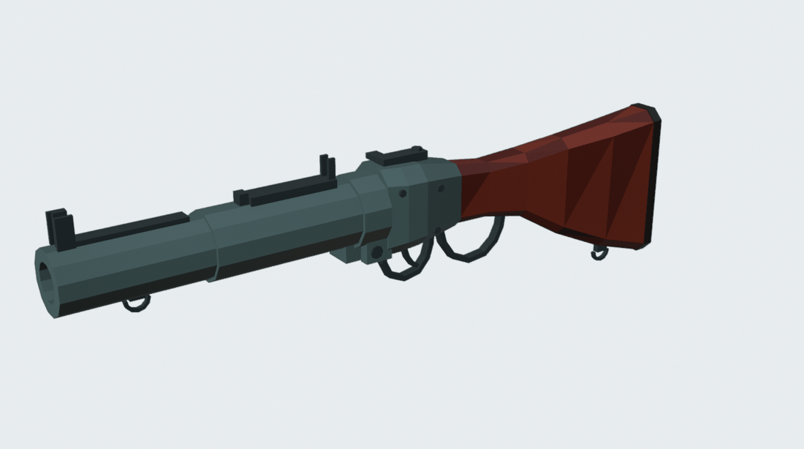
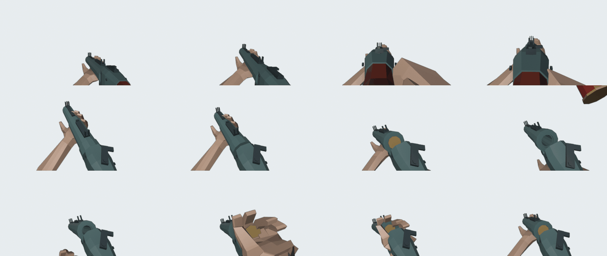
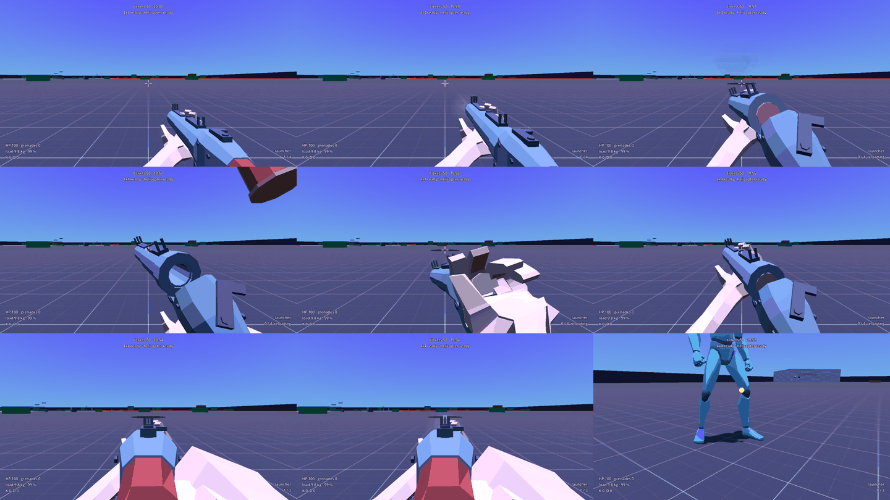

# Viewmodels

What the local player sees of the weapon in their hands. Until now every weapon was one static
`Mesh` on `WeaponDefinition`, moved between a hip and an aimed position; the launcher's was a
0.16 × 0.16 × 0.6 m box. The launcher is now a modelled, rigged and animated scene: a low-poly
break-action 40 mm launcher, held in the arms of `Models/Weapons/arms/arms.blend`, with idle,
fire, reload and sights-up clips driven from the simulation. Presentation only: nothing here feeds
the simulation or goes on the wire.



| Part | File |
|---|---|
| generator (model, rigs, clips, exports) | `tools/blender/launcher.py` |
| the scene it builds, to open by hand | `tools/blender/Launcher.blend` |
| world model: weapon alone, rigged, `idle` `fire` `reload` | `Models/Weapons/launcher/launcher.glb` |
| viewmodel: weapon in the arms, from the eye, `idle` `fire` `reload` `aim` `aim_fire` | `Models/Weapons/launcher/launcher_fp.glb` |
| arms source (yours; read, not modified) | `Models/Weapons/arms/arms.blend`, `ArmSkin.png` |
| what a weapon is drawn with | `Scripts/Fps/WeaponDefinition.cs`: `Viewmodel`, `ViewmodelFovDegrees` |
| drawing it | `Scripts/Fps/AnimatedViewmodel.cs`, `Scripts/Fps/WeaponInit.cs` |
| which clip, how far in (engine-free) | `Scripts/Sim/ViewmodelAnimation.cs`, tested by `Tests/ViewmodelAnimationTests.cs` |
| the engine check | `tools/EngineChecks/ViewmodelChecks.cs`, `scripts/viewmodel-checks.sh` |

## 1. The model

Built by script, as `tools/blender/gully_bridge.py` builds the bridge, so every dimension is a
number in `PARAMS` and the whole thing is rebuilt in about three seconds (§6). It follows the
concept rendering: a twelve-sided barrel (7.4 cm across, 35.5 cm long) stepping up behind its
front half, a collar where it meets the receiver, a faceted receiver with a latch lever on top,
a hinge pin under the breech, a trigger guard with a second loop behind it, a faceted red-brown
stock whose faces are split into triangles and a third of them a darker wood, a rubber butt pad,
sling swivels under the barrel and the stock, a folded leaf sight with a notch, and a front blade
between ears. Overall 0.77 m. The round is a 40 mm case: red body, tan rim and ogive head.

Flat-shaded, seven materials with flat colours, no textures. Triangles: launcher 1,234, of which
the round is 162; arms 1,200 (arms.blend's, mirrored).

The weapon's bones: `Weapon` (the whole gun), `Barrel` (hinged at the pin; drops 46° to open),
`Round` (a child of the barrel: the round in the chamber, the case thrown out and the fresh one
carried in), `Latch` (swings 38° to the right) and `Trigger` (16°). Every part is weighted wholly
to one bone. A node at the muzzle, `Muzzle` (`Muzzle_FP` in the viewmodel), is where the flash is
drawn from.

## 2. First-person arms: the avenues

The question was whether to use the new arms or the arms the player model already has. Facts,
measured by the engine check (§5) and by reading the rig:

- The local player's body is the Universal Animation Library mannequin (`Scenes/humanoid.tscn`,
  Quaternius, CC0), scaled to the 2 m capsule. For the local player it is set to cast its shadow
  and not be drawn (`fps_controller.ConfigureForRole`), so nobody looks out from inside a skull.
- It is one mesh of 8,546 vertices, head included: hiding the head for a first-person body means
  scaling the `Head` bone to nothing, not hiding a mesh. Its arm clips are a pistol's:
  `Pistol_Aim_*`, `Pistol_Shoot`, `Pistol_Reload`. Nothing holds a long gun, nothing breaks a
  launcher open.
- **The first-person camera is at the mannequin's knee, not its head.** Measured from an outside
  camera (last picture below): the eye is 1.06 m below the `Head` bone. `CameraController` rests at
  0.596 m in `Scenes/fps_controller.tscn`, and only the crouch, jump and slide animations move it
  to 1.5 m; a player who has not yet crouched or jumped sees from 0.6 m. Not changed here (§7).
- With the body drawn from that camera — hip, aimed, and looking 75° down — nothing of it is in
  view but one forearm when looking down.

Three ways to give the camera arms:

| | A. Arms of its own (built here) | B. The body the camera is in | C. Both |
|---|---|---|---|
| What | arms and weapon in one scene per weapon, authored from the eye; the body stays shadow-only | the mannequin drawn, its head hidden, the weapon in its right hand, the left hand by IK | A for the owner's camera; the world model in the mannequin's hand for everyone else and for the owner's shadow |
| Framing | exact: authored against the camera it is seen through | wherever the clip puts the hands; a body's aim pose puts them at the edge of view or out of it | A's |
| Field of view | its own (`fov_override`): 55° here against the game's 75° | the game's: at 107° across, held things look small and stretched | A's |
| Walls | does not clip into them (`z_clip_scale`) | clips into them as the body does | A's |
| Clips | per weapon, first-person only | one set for both views, but none exists for a long gun | A's per weapon; long-gun body clips later |
| Shadow and legs | shadow is the mannequin's pistol pose; no legs looking down (as now) | consistent | A's, with the weapon in the shadow |
| Needs first | nothing | the eye moved into the head; head hiding; long-gun clips; IK | A; then a hand attachment and the world model's clips |

**Recommendation: C, of which A is done.** A is what nearly every shipped shooter does for the
camera, because the view from the eye and the view of a body are framed for different things;
here B is not reachable without new body clips and the eye height fixed first. The second half of
C is small and the pieces exist: `launcher.glb` is the same weapon with the same clips on its own
bones, ready for a `BoneAttachment3D` on the mannequin's `hand_r` (as `HumanoidRig.Chest` hangs a
vest off `spine_03`), its `reload` driven by the same `ViewmodelAnimator` from a remote player's
`IsReloading` flag in the snapshot.

The arms are bare skin (`ArmSkin.png`); the body they belong to is a cyan mannequin. Sleeves or a
tint would match them; the texture is the place.



## 3. The viewmodel scene

What `WeaponDefinition.Viewmodel` takes. Any `PackedScene` with:

- one `AnimationPlayer` holding `idle` (looped), `fire` and `reload`; optionally `aim` (the sights
  up, one pose) and `aim_fire` (a round from there). A missing clip shows `idle`.
- one `Skeleton3D` that the clips pose: arms and weapon in one.
- a node whose name starts with `Muzzle`, at the end of the barrel.
- framed from the eye, looking down −Z, at `ViewmodelFovDegrees` (vertical). `Position` and
  `Rotation` offset it from there and are zero for one framed as held; with `aim` clips,
  `AimPosition` and `AimRotation` are zero too, because the sights are in the clip.

`AnimatedViewmodel` instantiates it under the `WeaponRig/Weapon` node once per weapon and keeps
it; `WeaponInit` hides the mesh while it is shown, and draws the mesh if the scene is not a 3D
one (the launcher keeps its box as that fallback). Every material is copied with
`use_fov_override` at `ViewmodelFovDegrees` and `use_z_clip_scale` at 0.4 (Godot 4.5+), and every
mesh casts no shadow. That replaces the disabled `WeaponViewport` sub-viewport in
`Scenes/fps_controller.tscn`, which was the pre-4.5 way to get both.

## 4. Driving it from the simulation

Polled on the render frame from the local player's equipped `WeaponState`, as the sights already
are (`LocalAim`); never pushed, never fed back (docs/NETCODE.md §3.1). `ViewmodelAnimator`:

- **Reload** is a span the state holds: the clip is placed at
  `1 − (ReloadEndTick − now) / ReloadTicks`, `now` being the simulated tick plus the render
  frame's fraction of the next. A server correction, a hitch or a reload longer than the clip
  (2.5 s each for the launcher) all show the barrel where the simulation has it.
- **Fire** is an edge: `ShotIndex` going up. The shot is dated `NextFireTick − TicksBetweenShots`,
  the tick the step that fired it set the cadence from, and shown for the clip's length from
  there. A weapon drawn with rounds already fired, a weapon switched to, and a count that went
  back to zero on a respawn are adopted without a shot.
- **Idle** loops on the render clock.
- **Sights**: `aim`/`aim_fire` are blended over the held clip bone by bone by the sights'
  progress, so the shoulders stay put and only weapon and hands come up. A reload takes them down
  over 0.15 s, and puts them back after.

The skeleton is reset to rest before each clip is sought: Godot drops tracks that never change
from an import, and a reload cut short must not leave the barrel open under `idle`. The two
`.glb.import` files keep them anyway (`animation/remove_immutable_tracks=false`).

The flash: drawn at the viewmodel's muzzle moved outward from the line of sight by
`ViewmodelOptics.Spread = tan(camera/2) / tan(viewmodel/2)` (1.474 at 75° and 55°), which puts it
on screen where the 55° barrel is. Measured: 751, 508 against 751, 508 px.

## 5. Checks

- `Tests/ViewmodelAnimationTests.cs`, from states the weapon step itself produces: no recoil on
  drawing, the fire clip from the shot's own tick and ending after its length, the reload half done
  half way, the reload over the recoil, respawn and weapon switch adopted, the spread's values and
  that it lands a point where the other lens draws it. `dotnet test`: 4,046 of 4,046 pass.
- `scripts/viewmodel-checks.sh` (Godot 4.6 .NET; `SHOTS=<dir>` adds screenshots under
  `xvfb-run`): a listen host gives its player the launcher and, through the input map, checks 19
  facts — drawn by the scene not the mesh, 42 bones in one skeleton, the muzzle node, every one
  of 8 surfaces at 55° with the depth scale and no shadow, idle, the shot's flash on the drawn
  barrel, the kick (4.4° at the fourth tick) and the settle, the empty launcher's next pull
  reloading it, the barrel 46° open part way and shut on a round at the end, the sights putting
  the muzzle at (0.000, −0.066, −0.601) m from the eye — 66 mm under the line of sight, 0.60 m
  out — a round from the sights, and the sights coming down. Then the body drawn from the eye and
  from outside (§2). Output: `docs/baselines/viewmodel-checks.txt`.



The test map's sky is a strong blue and tints the gunmetal blue and the skin pale; in Blender the
same materials are the concept's grey-green and skin.

## 6. Rebuilding

```
python3 -m pip install bpy==5.3.0        # Blender as a module; needs Python 3.13
python3 tools/blender/launcher.py        # or: blender --background --python tools/blender/launcher.py
```

It writes both `.glb` files and `tools/blender/Launcher.blend`, and prints where the notch, the
front blade and the muzzle are from the eye. Godot re-imports the `.glb` files on its next scan.
In `Launcher.blend` the arms are posed by IK: the right hand's target rides on the weapon, the
left one is keyed every frame from a timeline of what it holds (barrel, nothing, the round,
barrel). The glTF exporter samples the solved pose, so Godot gets plain bone rotations and no IK.

What the script changes from its sources, on its own copies only:

- arms.blend's arms are moved bodily (each its own shoulder), scaled 0.9 and their hands 0.8;
- arms.blend's `Skin` material has its image node unconnected — Blender's viewport shows it, a
  glTF carries only what is connected — so the copy connects it to the base colour;
- the viewmodel's muzzle is `Muzzle_FP` because Blender names are unique.

`Models/Weapons/arms/` has a `.gdignore`. Without it a headless Godot without a Blender path
stops at `arms.blend` ("Blender path is invalid or not set ... Cannot configure blender path in
headless mode") and imports nothing, which every `scripts/*-checks.sh` on a fresh checkout does;
with it the same import, on a clean copy of the tree, runs to the end and imports both `.glb`
files. The arms reach Godot through
`launcher_fp.glb`, which embeds their texture. Delete the file to have the editor import the
`.blend` directly.

## 7. Not done, and found on the way

- **Eye height** (§2): the first-person camera starts at 0.596 m and reaches 1.5 m only after a
  crouch, jump or slide. Shots leave from the camera (`fps_controller.EyePosition`), and
  docs/GROUND_VEHICLES.md already records the headless server at 0.596 m; changing it moves where
  every player's rounds come from, so it is left for its own change.
- `WeaponInit.SwayWeapon` computes a sway and never applies it: `AimWeapon` sets the node's
  position and rotation every frame and the sway's results are not read.
- The world model is exported, not yet used: nothing draws a remote player's weapon (§2, C).
- Only the launcher has a viewmodel; every other weapon is still its mesh.
- No reload sounds; the clips' beats (latch 6–10, open 10–17, case out 22, round in 46–52, shut
  58–62, of 75 frames at 30 fps) are where they would go.
